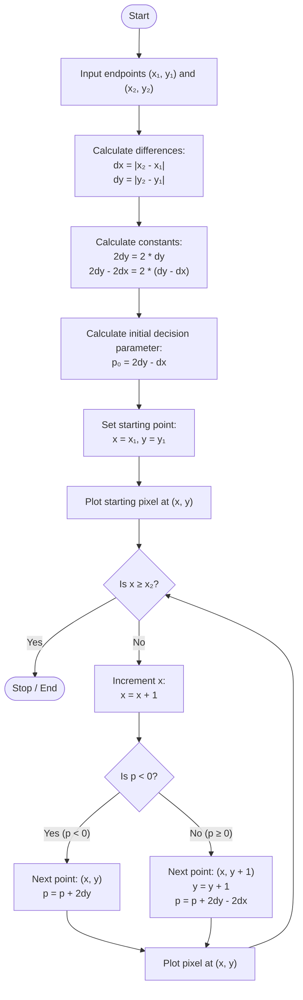

# Experiment 02: Bresenham’s Line Drawing Algorithm

> **Lab Final Headline:** *Draw a line using Bresenham’s line drawing algorithm.*

---

## 1. Objective
To rasterize a straight line using **Bresenham’s Line Drawing Algorithm** using pure **integer arithmetic** (avoiding floating-point calculations, division, and rounding operations) for lines with slope $|m| < 1$.

---

## 2. In-Depth Mathematical Formula Derivation

### 2.1 Problem Setup (First Octant: $0 \le m < 1, \Delta x > 0$)
Let the two endpoints be $(x_1, y_1)$ and $(x_2, y_2)$ where $x_1 < x_2$.
* Total horizontal change: $\Delta x = x_2 - x_1 > 0$
* Total vertical change: $\Delta y = y_2 - y_1 \ge 0$
* Slope: $m = \frac{\Delta y}{\Delta x}$, where $0 \le m < 1$.

At step $k$, having plotted pixel $(x_k, y_k)$, moving to column $x_k + 1$ requires choosing between two candidate pixels:
1. **East ($E$):** $(x_k + 1, y_k)$ — Same horizontal scanline.
2. **North-East ($NE$):** $(x_k + 1, y_k + 1)$ — One scanline higher.

---

### 2.2 Distance Error Formulation
The actual continuous line passes at $x = x_k + 1$ with true mathematical value:
$$y = m(x_k + 1) + c$$

The vertical distances from the true mathematical line to the lower pixel ($E$) and upper pixel ($NE$) are:
$$d_1 = y - y_k = m(x_k + 1) + c - y_k$$
$$d_2 = (y_k + 1) - y = y_k + 1 - [m(x_k + 1) + c]$$

The difference between the two distances:
$$d_1 - d_2 = 2m(x_k + 1) - 2y_k + 2c - 1$$

Substitute $m = \frac{\Delta y}{\Delta x}$:
$$d_1 - d_2 = 2\frac{\Delta y}{\Delta x}(x_k + 1) - 2y_k + 2c - 1$$

---

### 2.3 Deriving the Integer Decision Parameter $p_k$
Multiply by $\Delta x > 0$ to eliminate fractions and keep only integers:
$$p_k = \Delta x (d_1 - d_2) = 2\Delta y \cdot x_k - 2\Delta x \cdot y_k + C$$
where constant $C = 2\Delta y + \Delta x(2c - 1)$.

* **If $p_k < 0$ ($d_1 < d_2$):** Lower pixel $E(x_k + 1, y_k)$ is closer $\implies \mathbf{y_{k+1} = y_k}$.
* **If $p_k \ge 0$ ($d_1 \ge d_2$):** Upper pixel $NE(x_k + 1, y_k + 1)$ is closer $\implies \mathbf{y_{k+1} = y_k + 1}$.

---

### 2.4 Recurrence Relation for $p_{k+1}$
At step $k+1$:
$$p_{k+1} = 2\Delta y \cdot x_{k+1} - 2\Delta x \cdot y_{k+1} + C$$

Subtracting $p_k$:
$$p_{k+1} - p_k = 2\Delta y(x_{k+1} - x_k) - 2\Delta x(y_{k+1} - y_k)$$

Since $x_{k+1} = x_k + 1$:
$$p_{k+1} = p_k + 2\Delta y - 2\Delta x(y_{k+1} - y_k)$$

* **Case 1 ($p_k < 0$):** $y_{k+1} - y_k = 0$
  $$\mathbf{p_{k+1} = p_k + 2\Delta y}$$
* **Case 2 ($p_k \ge 0$):** $y_{k+1} - y_k = 1$
  $$\mathbf{p_{k+1} = p_k + 2\Delta y - 2\Delta x}$$

---

### 2.5 Initial Decision Parameter $p_0$
At the first point $(x_0, y_0) = (x_1, y_1)$, substitute $c = y_1 - \frac{\Delta y}{\Delta x}x_1$:
$$p_0 = 2\Delta y(x_1 + 1) - 2\Delta x \cdot y_1 + 2\Delta x\left(y_1 - \frac{\Delta y}{\Delta x}x_1\right) - \Delta x$$
$$\mathbf{p_0 = 2\Delta y - \Delta x}$$

---

## 3. Algorithm Steps

**Bresenham’s Line Algorithm (For slope $|m| < 1$, assuming $\Delta x > 0$):**

1. **Read endpoints** $(x_1, y_1)$ and $(x_2, y_2)$.
2. **Calculate constants:** $\Delta x, \Delta y, 2\Delta y$, and $2\Delta y - 2\Delta x$.
3. **Calculate initial decision parameter:**
   $$p_0 = 2\Delta y - \Delta x$$
4. **Set starting point** $(x_k, y_k) = (x_1, y_1)$. **Plot pixel.**
5. **For each $x_k$ along the line, evaluate $p_k$:**
   * **If $p_k < 0$:**
     - Next point is $(x_{k+1}, y_k)$
     - $p_{k+1} = p_k + 2\Delta y$
   * **If $p_k \ge 0$:**
     - Next point is $(x_{k+1}, y_k + 1)$
     - $p_{k+1} = p_k + 2\Delta y - 2\Delta x$
6. **Repeat step 5 until $x$ reaches $x_2$.**

---

## 4. Pseudocode

```text
Algorithm Bresenham_Line(x1, y1, x2, y2):
Input:  Line endpoints (x1, y1) and (x2, y2)
Output: Display rasterized line pixels

1.  dx = abs(x2 - x1)
2.  dy = abs(y2 - y1)
3.  two_dy = 2 * dy
4.  two_dy_minus_two_dx = 2 * (dy - dx)
5.  p = 2 * dy - dx

6.  x = x1
7.  y = y1

8.  PlotPixel(x, y)

9.  while (x < x2) do
10.     x = x + 1
11.     if (p < 0) then
12.         p = p + two_dy
13.     else
14.         y = y + 1
15.         p = p + two_dy_minus_two_dx
16.     end if
17.     PlotPixel(x, y)
18. end while

19. End
```

---

## 5. Vertical Flowchart



---

## 6. Hand Calculation / Numerical Trace Table Example

**Problem:** Draw a line from $(20, 10)$ to $(30, 18)$ using Bresenham’s Line Algorithm.

* $(x_1, y_1) = (20, 10)$, $(x_2, y_2) = (30, 18)$
* $\Delta x = 30 - 20 = 10$
* $\Delta y = 18 - 10 = 8$
* Slope $m = \frac{8}{10} = 0.8 < 1$
* Constants:
  - $2\Delta y = 2 \times 8 = 16$
  - $2\Delta y - 2\Delta x = 16 - 20 = -4$
* Initial decision parameter:
  - $p_0 = 2\Delta y - \Delta x = 16 - 10 = 6$

| $k$ | $p_k$ | Condition | Chosen Pixel $(x_{k+1}, y_{k+1})$ | $p_{k+1} = p_k + \Delta p$ |
|:---:|:---:|:---:|:---:|:---:|
| **0** | $6$ | $p_0 \ge 0$ | **(21, 11)** | $6 + (-4) = 2$ |
| **1** | $2$ | $p_1 \ge 0$ | **(22, 12)** | $2 + (-4) = -2$ |
| **2** | $-2$ | $p_2 < 0$ | **(23, 12)** | $-2 + 16 = 14$ |
| **3** | $14$ | $p_3 \ge 0$ | **(24, 13)** | $14 + (-4) = 10$ |
| **4** | $10$ | $p_4 \ge 0$ | **(25, 14)** | $10 + (-4) = 6$ |
| **5** | $6$ | $p_5 \ge 0$ | **(26, 15)** | $6 + (-4) = 2$ |
| **6** | $2$ | $p_6 \ge 0$ | **(27, 16)** | $2 + (-4) = -2$ |
| **7** | $-2$ | $p_7 < 0$ | **(28, 16)** | $-2 + 16 = 14$ |
| **8** | $14$ | $p_8 \ge 0$ | **(29, 17)** | $14 + (-4) = 10$ |
| **9** | $10$ | $p_9 \ge 0$ | **(30, 18)** | **Destination Reached** |

---

## 7. Complete C++ OpenGL Code

```cpp
#include <stdio.h>
#include <stdlib.h>
#include <math.h>
#define GL_SILENCE_DEPRECATION
#include <OpenGL/gl.h>
#include <GLUT/glut.h>

// Endpoints of the line
int x1_val, y1_val, x2_val, y2_val;

/*
 * Bresenham's Line Drawing Algorithm (For slope |m| < 1, assuming dx > 0)
 * Follows the standard 6-step algorithm:
 * 1. Read endpoints (x1, y1) and (x2, y2).
 * 2. Calculate constants: dx, dy, 2*dy, and 2*dy - 2*dx.
 * 3. Calculate initial decision parameter: p0 = 2*dy - dx.
 * 4. Set starting point (xk, yk) = (x1, y1). Plot pixel.
 * 5. For each xk along the line, evaluate pk:
 *    - If pk < 0: Next point is (x_{k+1}, yk),       p_{k+1} = pk + 2*dy
 *    - If pk >= 0: Next point is (x_{k+1}, yk + 1),  p_{k+1} = pk + 2*dy - 2*dx
 * 6. Repeat step 5 until x reaches x2.
 */
void bresenhamLine(int x1, int y1, int x2, int y2)
{
    // Step 2: Calculate constants: dx, dy, 2*dy, and 2*dy - 2*dx
    int dx = abs(x2 - x1);
    int dy = abs(y2 - y1);
    int twoDy = 2 * dy;
    int twoDyMinusTwoDx = 2 * (dy - dx);

    // Step 3: Calculate initial decision parameter: p0 = 2*dy - dx
    int p = 2 * dy - dx;

    // Step 4: Set starting point (xk, yk) = (x1, y1) and plot pixel
    int x = x1;
    int y = y1;
    int y_step = (y2 >= y1) ? 1 : -1;

    glVertex2i(x, y);

    // Step 5 & Step 6: Repeat until x reaches x2
    while (x < x2)
    {
        x++;
        if (p < 0)
        {
            // Case 1: pk < 0 -> Next point is (x_{k+1}, y_k)
            p += twoDy;
        }
        else
        {
            // Case 2: pk >= 0 -> Next point is (x_{k+1}, y_k + 1)
            y += y_step;
            p += twoDyMinusTwoDx;
        }
        glVertex2i(x, y);
    }
}

void display(void)
{
    glClear(GL_COLOR_BUFFER_BIT);
    glColor3f(0.0f, 1.0f, 0.0f); // Green color
    glPointSize(2.0f);
    glBegin(GL_POINTS);

    int x1 = x1_val;
    int y1 = y1_val;
    int x2 = x2_val;
    int y2 = y2_val;

    // Ensure x1 <= x2 so that dx > 0
    if (x1 > x2)
    {
        int tempX = x1; x1 = x2; x2 = tempX;
        int tempY = y1; y1 = y2; y2 = tempY;
    }

    // Call Bresenham's Line Algorithm
    bresenhamLine(x1, y1, x2, y2);

    glEnd();
    glFlush();
}

void init(void)
{
    glClearColor(0.0, 0.0, 0.0, 0.0);
    glMatrixMode(GL_PROJECTION);
    glLoadIdentity();
    glOrtho(0.0, 500.0, 0.0, 500.0, -1.0, 1.0);
}

int main(int argc, char **argv)
{
    // Step 1: Read endpoints (x1, y1) and (x2, y2)
    printf("Enter first point (x1 y1): ");
    scanf("%d %d", &x1_val, &y1_val);
    printf("Enter second point (x2 y2): ");
    scanf("%d %d", &x2_val, &y2_val);

    glutInit(&argc, argv);
    glutInitDisplayMode(GLUT_SINGLE | GLUT_RGB);
    glutInitWindowSize(500, 500);
    glutInitWindowPosition(100, 100);
    glutCreateWindow("Bresenham Line Drawing Algorithm");
    init();
    glutDisplayFunc(display);
    glutMainLoop();
    return 0;
}
```

---

## 8. Viva & Exam Highlights

1. **Why is Bresenham’s algorithm faster than DDA?**
   - Bresenham’s algorithm uses only **integer addition, subtraction, and bit shifting (multiplication by 2)**, completely eliminating expensive floating-point arithmetic and `round()` function calls.

2. **Why do we multiply $(d_1 - d_2)$ by $\Delta x$?**
   - To clear out the fraction from the slope $m = \frac{\Delta y}{\Delta x}$, resulting in pure integer decision parameters.

3. **What is the initial value of the decision parameter $p_0$?**
   - $p_0 = 2\Delta y - \Delta x$.

4. **What are the update rules for $p_{k+1}$?**
   - If $p_k < 0$: $p_{k+1} = p_k + 2\Delta y$ (y remains unchanged).
   - If $p_k \ge 0$: $p_{k+1} = p_k + 2\Delta y - 2\Delta x$ (y increments by 1).
