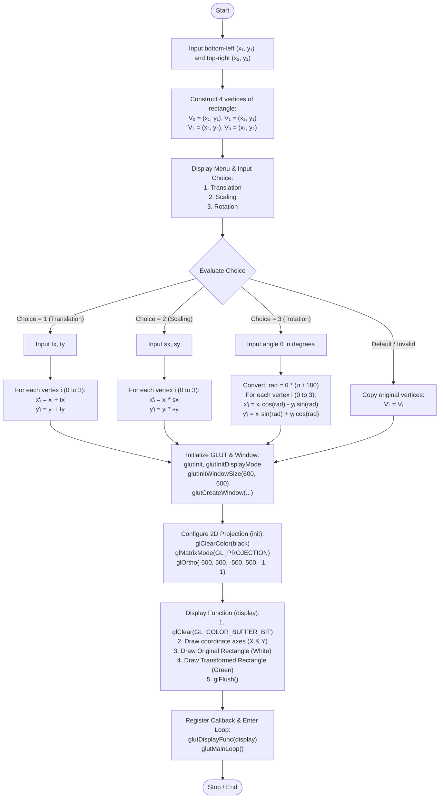

# Experiment 08: Basic Transformations on a Rectangle

> **Lab Final Headline:** *Write a program to perform basic 2D transformations (Translation, Scaling, Rotation) on a rectangle using OpenGL and GLUT.*

---

## 1. Objective
To implement, compute, and render basic 2D geometric transformations (**Translation**, **Scaling**, and **Rotation**) on a rectangle using pure mathematical matrix equations and visualize both the original and transformed objects with coordinate axes in **OpenGL** and **GLUT**.

---

## 2. In-Depth Mathematical Formulation & Matrices

### 2.1 Rectangle Representation
A 2D rectangle aligned with coordinate axes is defined by two diagonally opposite corners: bottom-left $(x_1, y_1)$ and top-right $(x_2, y_2)$. Its 4 vertices are ordered in a closed loop:
$$V_0 = (x_1, y_1), \quad V_1 = (x_2, y_1), \quad V_2 = (x_2, y_2), \quad V_3 = (x_1, y_2)$$

---

### 2.2 Homogeneous Coordinate Matrices ($3 \times 3$)

#### 1. Translation (Shifting by $t_x, t_y$):
Moves an object by adding offsets to every vertex:
$$x' = x + t_x, \quad y' = y + t_y$$

In matrix form:
$$\begin{bmatrix} x' \\ y' \\ 1 \end{bmatrix} = \begin{bmatrix} 1 & 0 & t_x \\ 0 & 1 & t_y \\ 0 & 0 & 1 \end{bmatrix} \begin{bmatrix} x \\ y \\ 1 \end{bmatrix}$$

---

#### 2. Scaling (Resizing by factors $s_x, s_y$ with respect to Origin):
Multiplies vertex coordinates by scale factors:
$$x' = x \cdot s_x, \quad y' = y \cdot s_y$$

In matrix form:
$$\begin{bmatrix} x' \\ y' \\ 1 \end{bmatrix} = \begin{bmatrix} s_x & 0 & 0 \\ 0 & s_y & 0 \\ 0 & 0 & 1 \end{bmatrix} \begin{bmatrix} x \\ y \\ 1 \end{bmatrix}$$
* $s_x = s_y > 1$: Uniform enlargement.
* $0 < s_x = s_y < 1$: Uniform reduction.
* $s_x \ne s_y$: Differential scaling (aspect ratio distortion).

---

#### 3. Rotation (Spinning by angle $\theta$ counter-clockwise around Origin):
Rotating point $(x, y)$ by angle $\theta$:
$$x' = x \cos\theta - y \sin\theta$$
$$y' = x \sin\theta + y \cos\theta$$

In matrix form:
$$\begin{bmatrix} x' \\ y' \\ 1 \end{bmatrix} = \begin{bmatrix} \cos\theta & -\sin\theta & 0 \\ \sin\theta & \cos\theta & 0 \\ 0 & 0 & 1 \end{bmatrix} \begin{bmatrix} x \\ y \\ 1 \end{bmatrix}$$
*(Note: $\theta$ in degrees must be converted to radians: $\text{rad} = \theta \times \frac{\pi}{180}$)*.

---

## 3. Algorithm Steps (with OpenGL and GLUT)

1. **Read Endpoints:** Input the two diagonal corners of the rectangle $(x_1, y_1)$ and $(x_2, y_2)$.
2. **Construct Vertex List:** Store the 4 vertices of the original rectangle:
   $$V_0 = (x_1, y_1), \quad V_1 = (x_2, y_1), \quad V_2 = (x_2, y_2), \quad V_3 = (x_1, y_2)$$
3. **Select Transformation Choice:** Display menu and read the user's choice:
   - `1`: Translation
   - `2`: Scaling
   - `3`: Rotation
4. **Compute Transformed Vertices:**
   * **If Translation (Choice 1):**
     - Read translation factors $(t_x, t_y)$.
     - For each vertex $i \in [0, 3]$:
       $$x'_i = x_i + t_x, \quad y'_i = y_i + t_y$$
   * **If Scaling (Choice 2):**
     - Read scale factors $(s_x, s_y)$.
     - For each vertex $i \in [0, 3]$:
       $$x'_i = x_i \cdot s_x, \quad y'_i = y_i \cdot s_y$$
   * **If Rotation (Choice 3):**
     - Read rotation angle $\theta$ in degrees.
     - Convert to radians: $\text{rad} = \theta \times \left(\frac{\pi}{180}\right)$.
     - For each vertex $i \in [0, 3]$:
       $$x'_i = x_i \cos(\text{rad}) - y_i \sin(\text{rad})$$
       $$y'_i = x_i \sin(\text{rad}) + y_i \cos(\text{rad})$$
5. **Initialize GLUT and Create Window:**
   - Call `glutInit(&argc, argv)`
   - Set display mode `glutInitDisplayMode(GLUT_SINGLE | GLUT_RGB)`
   - Set window size `glutInitWindowSize(600, 600)` and window position `glutInitWindowPosition(100, 100)`
   - Create window `glutCreateWindow("Basic 2D Transformations on Rectangle")`
6. **Configure 2D Projection (`init` function):**
   - Clear background color: `glClearColor(0.0, 0.0, 0.0, 0.0)`
   - Set matrix mode to projection: `glMatrixMode(GL_PROJECTION)`, `glLoadIdentity()`
   - Set 2D orthographic viewing box: `glOrtho(-500.0, 500.0, -500.0, 500.0, -1.0, 1.0)`
7. **Render Scene in Display Callback (`display` function):**
   - Clear color buffer: `glClear(GL_COLOR_BUFFER_BIT)`
   - Draw coordinate axes ($X$-axis and $Y$-axis from $-500$ to $+500$)
   - Draw **Original Rectangle** in **White** using `GL_LINE_LOOP` with vertices $V_0 \dots V_3$
   - Draw **Transformed Rectangle** in **Green** using `GL_LINE_LOOP` with vertices $V'_0 \dots V'_3$
   - Flush execution buffer: `glFlush()`
8. **Register Display Callback and Start Event Loop:**
   - `glutDisplayFunc(display)`
   - `glutMainLoop()`

---

## 4. Pseudocode

```text
Algorithm Basic_Transformations_Rectangle_OpenGL:
Input:  Bottom-left (x1, y1), Top-right (x2, y2), Choice, and Transformation parameters (tx, ty / sx, sy / angle)
Output: OpenGL rendered window displaying coordinate axes, original rectangle (white), and transformed rectangle (green)

// --- STEP 1: CONSTRUCT VERTICES ---
1.  Read (x1, y1) and (x2, y2)
2.  V[0] = (x1, y1)
    V[1] = (x2, y1)
    V[2] = (x2, y2)
    V[3] = (x1, y2)

// --- STEP 2: SELECT & COMPUTE TRANSFORMATION ---
3.  Read choice (1: Translation, 2: Scaling, 3: Rotation)

4.  Switch (choice) do:
        Case 1 (Translation):
            Read tx, ty
            For i = 0 to 3 do:
                V_new[i].x = V[i].x + tx
                V_new[i].y = V[i].y + ty
            End For

        Case 2 (Scaling):
            Read sx, sy
            For i = 0 to 3 do:
                V_new[i].x = V[i].x * sx
                V_new[i].y = V[i].y * sy
            End For

        Case 3 (Rotation):
            Read angle
            rad = angle * (PI / 180.0)
            For i = 0 to 3 do:
                V_new[i].x = V[i].x * cos(rad) - V[i].y * sin(rad)
                V_new[i].y = V[i].x * sin(rad) + V[i].y * cos(rad)
            End For

        Default:
            For i = 0 to 3 do:
                V_new[i] = V[i]
            End For
    End Switch

// --- STEP 3: OPENGL & GLUT INITIALIZATION ---
5.  glutInit(argc, argv)
6.  glutInitDisplayMode(GLUT_SINGLE | GLUT_RGB)
7.  glutInitWindowSize(600, 600)
8.  glutInitWindowPosition(100, 100)
9.  glutCreateWindow("Basic 2D Transformations on Rectangle")

// --- STEP 4: COORDINATE SYSTEM SETUP (init) ---
10. Procedure init():
        glClearColor(0.0, 0.0, 0.0, 0.0)
        glMatrixMode(GL_PROJECTION)
        glLoadIdentity()
        glOrtho(-500.0, 500.0, -500.0, 500.0, -1.0, 1.0)
    End Procedure

// --- STEP 5: DISPLAY CALLBACK (display) ---
11. Procedure display():
        glClear(GL_COLOR_BUFFER_BIT)
        
        // Draw coordinate axes
        DrawAxes(-500 to +500)
        
        // Draw Original Rectangle in White
        glColor3f(1.0, 1.0, 1.0)
        DrawLineLoop(V[0..3])
        
        // Draw Transformed Rectangle in Green
        glColor3f(0.0, 1.0, 0.0)
        DrawLineLoop(V_new[0..3])
        
        glFlush()
    End Procedure

12. init()
13. glutDisplayFunc(display)
14. glutMainLoop()
15. End
```

---

## 5. Vertical Flowchart



---

## 6. Hand Calculation / Numerical Trace Table Example

**Problem:** Perform Rotation by $\theta = 90^\circ$ counter-clockwise around the Origin $(0, 0)$ on a rectangle with vertices $(100, 100)$, $(200, 100)$, $(200, 200)$, and $(100, 200)$.

* $\theta = 90^\circ \implies \cos(90^\circ) = 0, \quad \sin(90^\circ) = 1$.
* Equations:
  $$x' = x(0) - y(1) = -y$$
  $$y' = x(1) + y(0) = x$$

| Vertex | Original $(x, y)$ | Transformation Calculation | Transformed Vertex $(x', y')$ |
|:---:|:---:|:---:|:---:|
| **$V_0$** | $(100, 100)$ | $x' = -100, \quad y' = 100$ | **(-100, 100)** |
| **$V_1$** | $(200, 100)$ | $x' = -100, \quad y' = 200$ | **(-100, 200)** |
| **$V_2$** | $(200, 200)$ | $x' = -200, \quad y' = 200$ | **(-200, 200)** |
| **$V_3$** | $(100, 200)$ | $x' = -200, \quad y' = 100$ | **(-200, 100)** |

---

## 7. Complete C++ OpenGL Code

```cpp
#include <stdio.h>
#include <stdlib.h>
#include <math.h>
#define GL_SILENCE_DEPRECATION
#include <OpenGL/gl.h>
#include <GLUT/glut.h>

#define PI 3.14159265358979323846f

// 4 vertices of Original and Transformed Rectangles
float rect[4][2];
float transformedRect[4][2];
int choice = 1;
float tx, ty, sx, sy, angle;

// Helper function to draw coordinate axes (X and Y)
void drawAxes(void)
{
    glColor3f(0.3f, 0.3f, 0.3f); // Gray axes
    glLineWidth(1.0f);
    glBegin(GL_LINES);
    glVertex2f(-500.0f, 0.0f);
    glVertex2f(500.0f, 0.0f);
    glVertex2f(0.0f, -500.0f);
    glVertex2f(0.0f, 500.0f);
    glEnd();
}

// Helper function to draw a rectangle given 4 vertices
void drawRect(float r[4][2])
{
    glBegin(GL_LINE_LOOP);
    for (int i = 0; i < 4; i++)
    {
        glVertex2f(r[i][0], r[i][1]);
    }
    glEnd();
}

// Display callback function
void display(void)
{
    glClear(GL_COLOR_BUFFER_BIT);

    // Draw reference coordinate axes
    drawAxes();

    // 1. Draw Original Rectangle in White
    glColor3f(1.0f, 1.0f, 1.0f);
    glLineWidth(2.0f);
    drawRect(rect);

    // 2. Draw Transformed Rectangle in Green
    glColor3f(0.0f, 1.0f, 0.0f);
    glLineWidth(2.0f);
    drawRect(transformedRect);

    glFlush();
}

// OpenGL initialization
void init(void)
{
    glClearColor(0.0f, 0.0f, 0.0f, 0.0f); // Black background
    glMatrixMode(GL_PROJECTION);
    glLoadIdentity();
    // Set 2D orthographic viewing coordinates (-500 to +500)
    glOrtho(-500.0, 500.0, -500.0, 500.0, -1.0, 1.0);
}

int main(int argc, char **argv)
{
    float x1, y1, x2, y2;

    // Step 1: Input rectangle corners
    printf("Enter bottom-left corner of rectangle (x1 y1): ");
    scanf("%f %f", &x1, &y1);
    printf("Enter top-right corner of rectangle (x2 y2): ");
    scanf("%f %f", &x2, &y2);

    // Step 2: Define 4 vertices of the rectangle
    rect[0][0] = x1; rect[0][1] = y1;
    rect[1][0] = x2; rect[1][1] = y1;
    rect[2][0] = x2; rect[2][1] = y2;
    rect[3][0] = x1; rect[3][1] = y2;

    // Step 3: Select transformation
    printf("\nSelect Basic 2D Transformation:\n");
    printf("1. Translation\n");
    printf("2. Scaling\n");
    printf("3. Rotation\n");
    printf("Enter your choice (1-3): ");
    scanf("%d", &choice);

    // Step 4: Compute transformation
    switch (choice)
    {
        case 1: // Translation: x' = x + tx, y' = y + ty
            printf("Enter translation factors (tx ty): ");
            scanf("%f %f", &tx, &ty);
            for (int i = 0; i < 4; i++)
            {
                transformedRect[i][0] = rect[i][0] + tx;
                transformedRect[i][1] = rect[i][1] + ty;
            }
            break;

        case 2: // Scaling: x' = x * sx, y' = y * sy
            printf("Enter scaling factors (sx sy): ");
            scanf("%f %f", &sx, &sy);
            for (int i = 0; i < 4; i++)
            {
                transformedRect[i][0] = rect[i][0] * sx;
                transformedRect[i][1] = rect[i][1] * sy;
            }
            break;

        case 3: // Rotation: x' = x*cos(rad) - y*sin(rad), y' = x*sin(rad) + y*cos(rad)
            printf("Enter rotation angle in degrees (counter-clockwise): ");
            scanf("%f", &angle);
            {
                float rad = angle * (PI / 180.0f);
                for (int i = 0; i < 4; i++)
                {
                    transformedRect[i][0] = rect[i][0] * cosf(rad) - rect[i][1] * sinf(rad);
                    transformedRect[i][1] = rect[i][0] * sinf(rad) + rect[i][1] * cosf(rad);
                }
            }
            break;

        default:
            printf("Invalid choice! Displaying original rectangle only.\n");
            for (int i = 0; i < 4; i++)
            {
                transformedRect[i][0] = rect[i][0];
                transformedRect[i][1] = rect[i][1];
            }
            break;
    }

    // Step 5: Initialize GLUT and create window
    glutInit(&argc, argv);
    glutInitDisplayMode(GLUT_SINGLE | GLUT_RGB);
    glutInitWindowSize(600, 600);
    glutInitWindowPosition(100, 100);
    glutCreateWindow("Basic 2D Transformations on Rectangle");

    // Step 6: Initialize OpenGL viewing projection
    init();

    // Step 7 & 8: Register display callback and start GLUT main loop
    glutDisplayFunc(display);
    glutMainLoop();
    return 0;
}
```

---

## 8. Viva & Exam Highlights

1. **Why do we use Homogeneous Coordinates in 2D Transformations?**
   - In standard Cartesian coordinates, translation is an additive operation ($x + t_x$) while rotation and scaling are multiplicative operations ($x \cdot s_x$). Homogeneous coordinates ($3 \times 3$ matrices) allow all geometric transformations to be represented uniformly as matrix multiplications and concatenated easily.

2. **What is the difference between Uniform Scaling and Differential Scaling?**
   - **Uniform Scaling:** $s_x = s_y$ (the aspect ratio and shape proportions are preserved).
   - **Differential Scaling:** $s_x \ne s_y$ (the aspect ratio is altered and the shape is stretched or distorted).

3. **What is the purpose of `glOrtho(-500.0, 500.0, -500.0, 500.0, -1.0, 1.0)`?**
   - It sets up a 2D orthographic coordinate viewing volume centered at the origin $(0, 0)$, enabling both positive and negative coordinates to be displayed accurately across all four quadrants.
